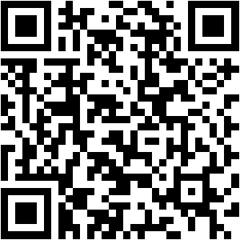

# HydroWise · Éco-spectateur (HydroWiseApp)

**Préserver l'eau durant les Jeux Olympiques d'hiver 2030.**

HydroWise est un projet qui aide à piloter l'eau des sites olympiques, de la neige de culture jusqu'au public. Ce dépôt contient **Éco-spectateur**, l'application qui permet aux spectateurs, aux habitants et aux bénévoles de participer : on scanne, on signale, on voit l'effet de ses gestes.

> **Prototype de démonstration.** Toutes les données affichées (consommations, économies, historique) sont **simulées**. Aucun serveur n'est utilisé.

## Essayer la démo

**Lien :** https://koumassiruthnaomi.github.io/HydroWiseApp/

**Ou scanner ce QR code :**

## Le problème

- Moins de neige naturelle, donc plus de neige artificielle, donc plus d'eau et d'énergie.
- Des milliers de personnes utilisent l'eau sur les sites pendant les Jeux.
- Les capteurs ne peuvent pas être partout, et personne ne voit ce que la consommation représente.

## Ce que fait l'application

| Fonction | Description |
|---|---|
| **Carte de la consommation** | Zones du site colorées selon l'objectif, classement des zones, conseil HydroWise sur le point d'eau à privilégier |
| **Signalement de fuite** | Lieu, type de problème, description et photo facultatives, envoi en quelques secondes |
| **Scan QR / NFC** | Informations et état du point d'eau, signalement pré-rempli (le scan est simulé dans la démo) |
| **Mes gestes** | Simulateur de durée de douche, score éco sur 10, économies en litres, badges |
| **Vue HydroWise (technicien)** | Réception des signalements avec statut (nouveau, en cours, résolu), historique par jour, alertes, statistiques globales |

## Comment ça s'insère dans HydroWise

HydroWise réunit trois idées : mesurer l'eau en temps réel (AquaPulse), prévoir la neige au juste besoin (SnowWise) et impliquer le public (Éco-spectateur). L'application est l'interface publique du système : le public envoie, le tableau de bord technique reçoit.

Dans cette démo, la vue « HydroWise » **simule** la réception côté technicien. En version réelle, chaque signalement serait envoyé vers l'API de la plateforme.

## Utilisation

Aucune installation : c'est un fichier HTML unique.

1. Ouvrir `index.html` dans un navigateur, ou utiliser le lien de démo ci-dessus.
2. Choisir **Spectateur** ou **Technicien** sur l'écran d'accueil.
3. Parcours conseillé : ouvrir la carte, faire « Simuler un scan », envoyer un signalement, puis passer sur la vue HydroWise pour le voir arriver.

Les signalements sont conservés dans le navigateur de l'appareil (`localStorage`) : ils ne passent pas d'un téléphone à un autre.

## Technologies

HTML, CSS et JavaScript, sans dépendance externe. Le QR code encode l'adresse de la démo.

## Limites actuelles

- Données simulées, pas de capteurs réels.
- Pas de serveur ni de base de données : les signalements restent dans le navigateur.
- Scan QR / NFC simulé par un bouton.
- Le conseil HydroWise est une règle simple basée sur les consommations par zone, pas de l'intelligence artificielle.
- Pas de mode hors ligne, pas de comptes utilisateurs.
- L'objectif de 40 L par personne et par jour est une simplification du prototype, il devrait être adapté à chaque type de zone.

## Prochaines étapes

- Connecter l'application à une API et à une base de données.
- Relier les signalements aux capteurs de la plateforme.
- Mettre en place un vrai scan de QR codes et de puces NFC sur des points d'eau.
- Tester sur un site pilote, avec de vraies données de fréquentation et de consommation.
- Définir qui exploite et maintient le système après les Jeux.

## Équipe

[À COMPLÉTER : noms des membres de l'équipe, avec ton nom et ton rôle (par exemple : « Ruth Koumassi : application et QR code »)]

Projet d'équipe réalisé dans le cadre de la co-création 2026 autour des Jeux Olympiques d'hiver 2030. Prix Protothèque.

## Licence

[À COMPLÉTER : à choisir avec l'équipe. Si le code peut être réutilisé, par exemple MIT ; sinon, « Tous droits réservés »]
